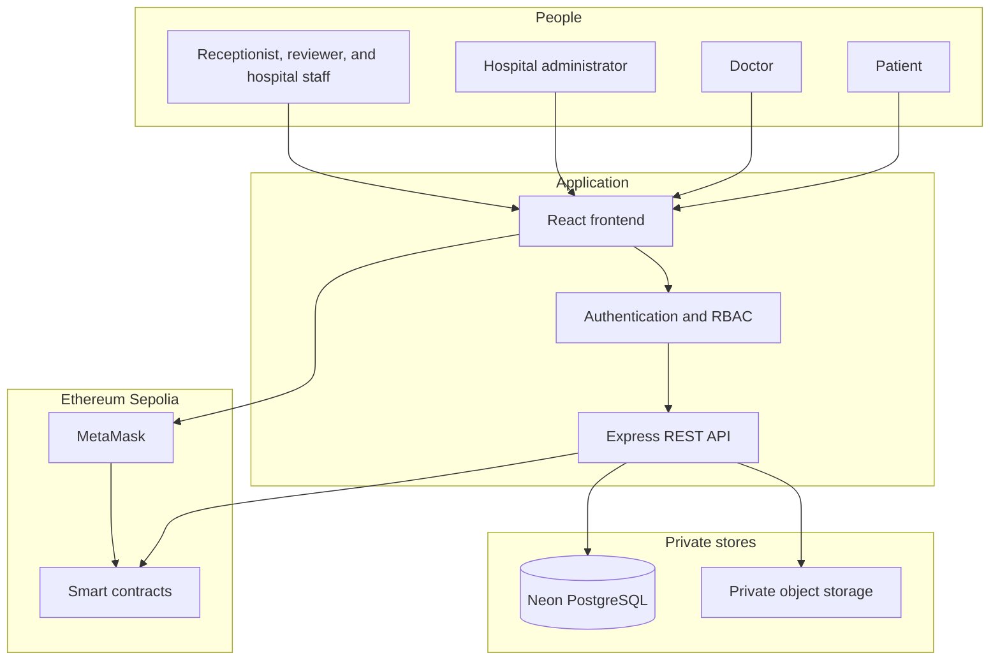

# MedChain — Blockchain-Based Lifetime Electronic Health Record System

[](https://medchain-silk.vercel.app)
[](https://medchain-backend-e054.onrender.com/health)
[](https://sepolia.etherscan.io)
[](https://react.dev)
[](https://expressjs.com)
[](https://neon.tech)
[](https://soliditylang.org)

MedChain is a lifetime electronic health record system for a hospital. A patient keeps one identity across visits. The patient decides which clinical wallet may read the chart. Ethereum records opaque references, commitments, consent, emergency grants, record hashes, and audit codes. Names, contact details, clinical text, files, passwords, and activation codes stay in the private application.

**Live application:** [https://medchain-silk.vercel.app](https://medchain-silk.vercel.app)

**API health:** [https://medchain-backend-e054.onrender.com/health](https://medchain-backend-e054.onrender.com/health)

**Source:** [github.com/chitrasen07/MedChain-Blockchain-Based-Lifetime-Electronic-Health-Record-System](https://github.com/chitrasen07/MedChain-Blockchain-Based-Lifetime-Electronic-Health-Record-System)

## Contents

1. [Problem statement](#problem-statement)
2. [Proposed solution](#proposed-solution)
3. [Key features](#key-features)
4. [System architecture](#system-architecture)
5. [Technology stack](#technology-stack)
6. [Smart contracts](#smart-contracts)
7. [Role-based access control](#role-based-access-control)
8. [Main workflows](#main-workflows)
9. [Project structure](#project-structure)
10. [Installation and local setup](#installation-and-local-setup)
11. [Deployment](#deployment)
12. [Screenshots](#screenshots)
13. [Testing](#testing)
14. [Current limitations](#current-limitations)
15. [Future enhancements](#future-enhancements)
16. [Academic project](#academic-project)
17. [License](#license)

## Problem statement

Hospital records are often split across departments, paper files, and separate software systems. A later visit may not see an earlier diagnosis, allergy, or laboratory result. Similar demographic details can create a second patient identity. Access lists are difficult to audit, and a copied document can be changed without a durable integrity check. A patient who changes doctors has little practical control over who continues to read the chart.

## Proposed solution

MedChain gives each confirmed patient a lifetime identifier in PostgreSQL and an opaque `bytes32` reference on Ethereum. Registration can attach the patient's MetaMask wallet immediately, or store a claim commitment so the patient links that wallet later. Clinical entries are encrypted in PostgreSQL. A consenting clinical wallet may anchor a hash of a record version on Sepolia. The hash can be checked later. The clinical text is not an argument to the contract.

Staff sign in with a hospital account. Application roles limit each API route to one hospital. Clinical chain roles are assigned separately by the hospital administrator wallet. A verified staff wallet, an approved chain role, and a verified professional profile are three different states. Patient consent is a fourth check, enforced before a chart is decrypted.

## Key features

### Patient module

- Lifetime patient ID, such as `PATIENT-000001`, stored off-chain, with an opaque on-chain reference.
- MetaMask sign-in through a one-time challenge. The portal opens only when that wallet is the on-chain controller.
- Registration with the patient's wallet now, or a recovery commitment for a later claim.
- Ownership claim on PatientRegistryV2 with an immediate `claimController` call. The wallet signs the patient reference and claim commitment, so a copied transaction cannot choose a different account.
- Patients who remain on the original PatientRegistry still use that contract's announce-and-reveal claim. The reveal delay on that contract is one hour.
- Encrypted chart: diagnoses, prescriptions, allergies, treatments, laboratory results, and visits.
- Medical file upload, preview, and download for PDF, JPG, and PNG files up to 10 MB. Files are encrypted before storage. Upload does not send a wallet transaction.
- Consent grant and revocation from the patient controller wallet.
- Emergency QR identification card and a health-summary PDF.
- Doctor discovery for chain-authorized doctors in the same hospital, including specialization, qualifications, experience, department, consultation hours, and credential status.
- Appointment request with a preferred date, time, and optional reason. Booking does not send a MetaMask transaction.
- Personal activity history for the signed-in patient.

Consultation hours are informational. They are not reserved appointment slots. Unverified professional details are labeled as unverified.

### Doctor module

- Email and password sign-in, limited to the doctor's hospital.
- One-time staff activation. The doctor sets a password and verifies a personal Sepolia wallet. The activation code is shown once to the administrator and is stored only as a hash.
- Blockchain role approval remains a separate MetaMask transaction by the hospital administrator. Activation does not grant clinical permissions by itself.
- Professional profile: name, biography, photograph, qualifications, specialization, registration, experience, department, designation, languages, and consultation hours. The assigned hospital and application role cannot be changed from this page.
- Credential review by the hospital administrator. A verified wallet does not verify a medical qualification. Important credential edits return the profile to pending review.
- Patient lookup and consent-based chart access.
- Clinical record creation and correction. Record text stays encrypted off-chain.
- Medical report upload, preview, and download through the same private file store.
- Appointment approval, reschedule, rejection, cancellation, and completion, with overlap protection.
- Emergency access for a bounded period, at most 72 hours, followed by a cooldown.
- Activity history for the signed-in doctor.
- Hash anchoring prepared for the doctor's own wallet after consent. The hospital administrator wallet cannot anchor a record.

Profile photographs use the private object store. When that store is not configured, the text profile still saves and the photo request reports that storage is unavailable.

### Hospital administrator module

- Hospital overview for staff, registration, and duplicate review.
- Patient matching and registration. A possible duplicate becomes a review case and is not registered again.
- Staff creation for receptionist, doctor, reviewer, and hospital staff.
- Deferred activation: name, work email, and role now, with a one-time code the staff member uses on another computer. The code can be regenerated. The previous code stops working.
- Immediate wallet linking remains available when the staff member is present. The hospital administrator wallet cannot be saved as a staff wallet.
- Wallet verification status, shown separately from blockchain authorization and professional credential review.
- Shortened wallet display, copy of the complete address, and a control that reveals the full address.
- MetaMask approval and revocation of clinical chain roles.
- Review of a doctor's professional credentials.
- Role changes and account disabling. Disabling does not delete the account.
- Hospital-scoped activity history.

### Additional roles

| Role | Responsibilities | Restrictions |
| --- | --- | --- |
| Receptionist | Patient matching and patient lookup | Cannot register a patient, open the clinical chart, manage staff, or use a blockchain wallet |
| Hospital staff | Patient registration, vitals, visit notes, laboratory intake, work queue, clinical records, and emergency access | Clinical reads require the staff member's own wallet, an active chain role, and consent or an active emergency grant. Cannot approve their own chain role |
| Reviewer | Duplicate-identity queue and patient matching | Cannot create staff, register a patient directly, or read the clinical chart |

Hospital staff chain roles are Nurse, Lab technician, Pharmacist, and Specialist. The doctor application role uses the Doctor chain role. Receptionists and reviewers do not require a wallet.

### Security and blockchain

- Application RBAC loaded from the database on each request. A forged hospital claim in a token is not used as the hospital boundary.
- Patient consent and hospital isolation before a chart is decrypted.
- Ethereum Sepolia, chain ID `11155111`.
- MetaMask approval for patient claims, consent, role assignment, emergency requests, and record-hash anchors. Ordinary profile edits and appointment booking do not send a transaction.
- Immediate ownership claim on PatientRegistryV2, and the original one-hour claim path for a patient who is still on PatientRegistry.
- Append-only record hashes. A later version does not replace an earlier hash.
- AES-256-GCM for clinical JSON. Passwords use scrypt. Medical file keys are derived with HKDF from the profile encryption key.
- Private S3-compatible object storage, used for Cloudflare R2 when the endpoint and credentials are set. Buckets are not made public. Profile photographs use a separate key prefix from medical files.
- JWT sessions of 15 minutes. The `medchain_session` cookie is HttpOnly. A page refresh calls `GET /auth/session` and does not create another login event. Cookie writes require the `X-Medchain-Request` header.
- Password change increments the token version and ends the current cookie. Sign-out clears the cookie. It does not increment the token version, so the token remains valid until its 15-minute expiry.
- Staff activation codes are random, hashed, single-use, bound to the account and hospital, and expire after 24 hours by default. Repeated failures invalidate the open code. Codes, passwords, and wallet secrets are not written to logs, audit metadata, or chain transactions.
- Emergency chart access is limited to allergies, diagnoses, prescriptions, and laboratory results.
- Off-chain activity records for supported application actions, plus Sepolia `AuditLog` codes for on-chain actions. The database log is hospital-scoped. It is not itself a blockchain record.

## System architecture



The browser calls the API for profiles, charts, files, appointments, and audit history. The API reads Sepolia to check controllers, roles, consent, and emergency grants. MetaMask sends a transaction only after the holder of that wallet approves it.

### On-chain and off-chain data

| On Ethereum | Off-chain |
| --- | --- |
| Opaque patient and record references | Lifetime patient ID and demographic profile |
| Identity and claim commitments | Recovery secrets and activation codes |
| Controller and staff wallet addresses | Password hashes and session tokens |
| Consent windows and emergency grants | Diagnoses, prescriptions, notes, and laboratory text |
| Record-version hashes and audit action codes | Encrypted medical files and profile photographs |
| Role assignments | Appointments, professional profiles, and application audit history |

Anyone who can read Sepolia can see the values stored there. Restricted Solidity visibility does not make those values confidential. Clinical text is not written to Ethereum.

## Technology stack

Versions below are the ranges declared in the package manifests.

| Area | Technology | Purpose |
| --- | --- | --- |
| Frontend | React 19, React DOM, React Router 7 | Role workspaces and patient portal |
| Frontend build | Vite 8, Tailwind CSS 4, oxlint | Development server, production build, and lint |
| Frontend libraries | Browser wallet calls, `@noble/hashes`, `qrcode`, `lucide-react` | MetaMask signing, commitments, emergency QR, and icons |
| Backend | Node.js, Express 4, Zod 4 | REST API and request validation |
| Backend libraries | `pg`, `jsonwebtoken`, `ethers` 6, `helmet`, `cors`, `express-rate-limit`, `dotenv` | Database, sessions, Sepolia reads and hospital registration, headers, and limits |
| Tests | Node.js built-in test runner, Supertest, Hardhat Toolbox | API, interface, and contract tests |
| Database | PostgreSQL, hosted on Neon in deployment | Patients, staff, charts, files metadata, appointments, and audit rows |
| Blockchain | Solidity 0.8.24, OpenZeppelin Contracts 5, Hardhat 2 | Contracts, compiler, and in-memory tests |
| Wallet | MetaMask on Sepolia | Patient ownership, consent, staff roles, emergency access, and hash anchors |
| Authentication | JWT, HttpOnly cookie, scrypt passwords, wallet signatures | Staff and patient sessions |
| Encryption | AES-256-GCM and HKDF | Profiles, clinical JSON, and medical files |
| Object storage | S3-compatible API, Cloudflare R2 when configured | Private medical files and profile photographs |
| Deployment | Vercel, Render, Neon | Frontend, API, and database |
| Version control | Git and GitHub | Source history |

## Smart contracts

The contracts are already deployed. Do not run `blockchain/scripts/deploy.js` or `blockchain/scripts/deploy-v2.js` against Sepolia again.

RoleManager and AuditLog are shared. PatientRegistryV2 and its consent, emergency, and record-registry deployments use those existing contracts. Patients already stored on the original PatientRegistry remain on that registry until an explicit migration is run. `blockchain/deployments/sepolia-v2.json` records that migration as not run.

| Contract | Purpose | Main responsibilities |
| --- | --- | --- |
| RoleManager | Hospital role registry | Assigns Doctor, Nurse, Lab technician, Pharmacist, Specialist, Hospital admin, and related roles through OpenZeppelin AccessControl |
| AuditLog | On-chain audit codes | Appends action codes from authorized contracts. The human-readable event text stays off-chain |
| PatientRegistry | Original patient registry | Opaque reference, identity commitment, and the one-hour announce-and-reveal claim |
| RecordAccessControl | Consent for the registry it is bound to | Grant and revoke by the patient controller only |
| EmergencyAccess | Break-glass access | One grant per responder, from one second through 72 hours, then a 72-hour cooldown |
| MedicalRecordRegistry | Record integrity | Append-only `keccak256` hashes of stable clinical JSON |
| PatientRegistryV2 | Current registration registry | Same registration shape, with immediate `claimController` and no claim delay |

### Sepolia addresses

Original deployment, from `blockchain/deployments/sepolia.json`:

| Contract | Address |
| --- | --- |
| RoleManager | `0xDE4331A5D901B1aBBbE98B51F075e5D0A5894B78` |
| AuditLog | `0x85175F99DB99613DF7ce8452dd7C16eF475431B6` |
| PatientRegistry | `0xDe1501AF8BACc3c1040788AFb8d2f784Ab8e2806` |
| RecordAccessControl | `0xe520020bDBE95039697e93B4305cDCe7e682CEa6` |
| EmergencyAccess | `0x7c662d0649eDa6406Decd37020a2aD3ea811Fbd6` |
| MedicalRecordRegistry | `0x83A6DB7481E7037b9fBd063f14bE50097f8258Cd` |

Instant-claim deployment, from `blockchain/deployments/sepolia-v2.json`:

| Contract | Address |
| --- | --- |
| PatientRegistryV2 | `0xE2aF3A6f7FfB2152042c989594BF6Ca5c0aDe1BD` |
| RecordAccessControl bound to V2 | `0xB914033Add7bC3C1e8e77f61BE7AB089C6801962` |
| EmergencyAccess bound to V2 | `0xe9db76F4EBCe58C24e4BA66083eA75Dc90526Cd3` |
| MedicalRecordRegistry bound to V2 | `0xF5069561ADE26434baA789dc7C6A4DfD8915dF79` |

The public hospital administrator address recorded for that deployment is `0xD272a1e1027CDCDeA3ebbB8A9D01977e2030547F`.

When the four V2 addresses are configured, new registrations are submitted to PatientRegistryV2. The API still recognizes a patient that exists only on the original registry and uses the contracts bound to that registry.

## Role-based access control

Five checks stay separate:

1. **Account activation.** A pending staff account cannot sign in. The staff member sets a password with the one-time code.
2. **Wallet verification.** A clinical role signs a personal wallet challenge. Receptionists and reviewers skip this step.
3. **Blockchain authorization.** The hospital administrator approves the chain role in MetaMask. A valid activation code does not grant it.
4. **Professional credential verification.** A hospital administrator reviews a doctor's submitted qualifications. This is not a chain transaction.
5. **Patient consent.** Chart decryption requires a current grant or a current emergency grant for that wallet.

| Action | Patient | Doctor | Administrator | Receptionist | Hospital staff | Reviewer |
| --- | --- | --- | --- | --- | --- | --- |
| Sign in | Own wallet | Password | Password | Password | Password | Password |
| Match or look up a patient | Own record | Yes | Yes | Yes | Yes | Matching and review |
| Register a patient | No | No | Yes | No | Yes | No |
| Resolve a duplicate review | No | No | Yes | No | No | Yes |
| Manage staff and chain roles | No | No | Yes | No | No | No |
| Edit own professional profile | No | Yes | No | No | No | No |
| Approve professional credentials | No | No | Own hospital | No | No | No |
| Read a chart | Own chart | Consent or emergency | No | No | Consent or emergency | No |
| Write clinical records | No | Consent | No | No | Consent, for the staff workflows | No |
| Anchor a record hash | No | Own wallet, with consent | No | No | No | No |
| Request emergency access | No | Own clinical wallet | No | No | Own clinical wallet | No |
| Grant or revoke consent | Own wallet | No | No | No | No | No |
| Book or manage appointments | Request and cancel | Approve and update | No | No | No | No |

## Main workflows

### Patient registration and lifetime identity

A receptionist, administrator, reviewer, or hospital staff member can match a profile inside the hospital. A high-confidence match returns the existing patient. A possible match opens one review case. An administrator or hospital staff member registers only when matching allows it. The API submits `registerPatient` with the hospital wallet, stores the lifetime ID, and keeps the encrypted profile in PostgreSQL. The friendly ID is not the on-chain identifier.

### Deferred patient wallet ownership

Registration can store a claim commitment and leave the controller unset. The recovery secret stays in the browser. On PatientRegistryV2 the patient signs the claim and submits `claimController` without a waiting period. On the original PatientRegistry the patient announces the claim, waits one hour, and then reveals it. The reveal places the secret in public transaction data, so that secret is used once.

### Staff activation

The administrator enters the name, work email, and role, and chooses whether to link the wallet now or later. Later creates a pending account and displays one activation code. The staff member opens **Activate staff account** on the hospital sign-in page, enters the email, code, and a new password, and connects MetaMask when the role is clinical. The account becomes active. The chain role remains pending until the administrator approves it.

### Doctor chain role and credentials

After wallet verification, the administrator submits the role transaction from the hospital administrator wallet. Separately, the doctor completes a professional profile. The administrator approves or requests changes. Patients see the verification status with the profile. Booking still depends on an active doctor account and an active Doctor chain role, not on the credential badge alone.

### Consent, records, and files

The patient grants or revokes access from the controller wallet. A doctor or hospital staff member connects a clinical wallet. The API checks the chain role, consent or emergency state, and hospital before decrypting. New clinical JSON is encrypted and stored with its content hash. File bytes are encrypted with AES-256-GCM and written to the private object store under a hospital-scoped key. The database stores the key reference and metadata, not a public file URL.

### Emergency QR

The emergency card identifies the patient and exposes the limited emergency summary. It does not include the rest of the chart or recovery material.

### Appointments

The patient selects an eligible doctor and submits a preferred time in Asia/Kolkata. The doctor confirms the date, time, department, room, and instructions, or reschedules, rejects, cancels, or completes the visit. Confirmed times cannot overlap for that doctor. The patient portal shows the resulting status.

### Audit

Supported actions record the actor, role, hospital, affected account or record, time, and outcome. Patients, doctors, hospital staff, and administrators see the activity their role is allowed to see. Chain contracts additionally append fixed action codes to AuditLog. Background polling is not written as a new audit event.

## Project structure

```text
.
├── backend/
│   ├── migrations/          SQL migrations 001 through 019
│   ├── src/                 Express API, database, chain adapter, crypto, files
│   ├── test/                API and workflow tests
│   └── .env.example
├── blockchain/
│   ├── contracts/           Solidity sources
│   ├── deployments/         Sepolia address records
│   ├── scripts/             Local and already-used deployment scripts
│   ├── test/                Hardhat tests
│   └── hardhat.config.js
├── frontend/
│   ├── src/components/      Shared interface components
│   ├── src/config/          Role workspaces
│   ├── src/context/         Session state
│   ├── src/features/        Staff, clinical, appointment, and profile screens
│   ├── src/lib/             API client, wallet, and chart helpers
│   ├── src/pages/           Route pages
│   ├── src/services/        Role-specific request helpers
│   ├── test/                Frontend unit tests
│   └── .env.example
├── render.yaml              Render service definition, without secret values
└── README.md
```

`npm install` creates `node_modules`. The frontend build creates `frontend/dist`. Hardhat creates `blockchain/cache` and `blockchain/artifacts`. Those directories are generated and are not part of the design.

## Installation and local setup

### Prerequisites

- Node.js 20 or later
- npm
- PostgreSQL 14 or later for a local database, or a Neon project
- MetaMask, with the Sepolia network, for wallet flows
- A Sepolia RPC URL when blockchain mode is enabled

### Clone and install

```bash
git clone https://github.com/chitrasen07/MedChain-Blockchain-Based-Lifetime-Electronic-Health-Record-System.git
cd MedChain-Blockchain-Based-Lifetime-Electronic-Health-Record-System
npm install --prefix backend
npm install --prefix frontend
npm install --prefix blockchain
```

### Backend environment

Copy `backend/.env.example` to `backend/.env`. Replace every placeholder. Do not commit the filled file.

```text
PORT=3000
DATABASE_URL=postgres://medchain:<YOUR_DATABASE_PASSWORD>@localhost:5432/medchain
JWT_SECRET=<YOUR_EXISTING_RANDOM_JWT_SECRET>
BOOTSTRAP_SECRET=<YOUR_EXISTING_BOOTSTRAP_SECRET>
IDENTITY_COMMITMENT_KEY=<YOUR_EXISTING_IDENTITY_COMMITMENT_KEY>
PII_ENCRYPTION_KEY=<YOUR_64_HEX_CHARACTER_ENCRYPTION_KEY>
BLOCKCHAIN_ENABLED=true
RPC_URL=https://ethereum-sepolia-rpc.publicnode.com
PATIENT_REGISTRY_ADDRESS=0xDe1501AF8BACc3c1040788AFb8d2f784Ab8e2806
BLOCKCHAIN_PRIVATE_KEY=<SEPOLIA_HOSPITAL_ADMIN_PRIVATE_KEY>
CORS_ORIGIN=http://localhost:5173
DEMO_DISABLE_RATE_LIMIT=false
```

`PII_ENCRYPTION_KEY` is 64 hexadecimal characters. `BLOCKCHAIN_ENABLED=false` starts the API without a chain. Registration then returns HTTP 503, and the RPC, registry, and private key are not required.

Optional variables:

```text
CHAIN_ID=11155111
STAFF_ACTIVATION_HOURS=24
TRUST_PROXY=0
THIRDWEB_SECRET_KEY=
PATIENT_REGISTRY_V2_ADDRESS=0xE2aF3A6f7FfB2152042c989594BF6Ca5c0aDe1BD
RECORD_ACCESS_V2_ADDRESS=0xB914033Add7bC3C1e8e77f61BE7AB089C6801962
EMERGENCY_ACCESS_V2_ADDRESS=0xe9db76F4EBCe58C24e4BA66083eA75Dc90526Cd3
MEDICAL_RECORD_REGISTRY_V2_ADDRESS=0xF5069561ADE26434baA789dc7C6A4DfD8915dF79
MEDICAL_FILE_S3_BUCKET=<PRIVATE_BUCKET_NAME>
MEDICAL_FILE_S3_ACCESS_KEY_ID=<OBJECT_STORAGE_ACCESS_KEY>
MEDICAL_FILE_S3_SECRET_ACCESS_KEY=<OBJECT_STORAGE_SECRET>
MEDICAL_FILE_S3_ENDPOINT=<S3_COMPATIBLE_ENDPOINT>
MEDICAL_FILE_S3_REGION=auto
```

Leave the V2 variables empty when the API is started from a full checkout. It then reads `blockchain/deployments/sepolia-v2.json`. Set all four together on a host that does not contain that file. Leave the file variables empty to run without object storage. Text records still save. File and photo uploads return a clear unavailable response.

The file variables must be set together. The bucket stays private. Do not enable public bucket access.

### Database

Create an empty database and a login role. From `backend/`:

```bash
npm run migrate
```

Migrations `001` through `019` run in filename order. An applied file is not edited. `npm start` does not migrate automatically. Do not drop the database to reapply an old file.

### Start the applications

```bash
cd backend
npm start
```

The API listens on port 3000. In another terminal:

```bash
cd frontend
npm run dev
```

Copy `frontend/.env.example` to `frontend/.env` first:

```text
VITE_API_URL=http://localhost:3000
```

Leave `VITE_LOCAL_PATIENT_REGISTRY`, `VITE_LOCAL_RECORD_ACCESS`, `VITE_LOCAL_EMERGENCY_ACCESS`, and `VITE_LOCAL_MEDICAL_RECORD_REGISTRY` unset. Those values are only for a local Hardhat chain and are not Sepolia addresses.

Open `http://localhost:5173`. `CORS_ORIGIN` must be that origin for local browser calls.

### MetaMask and Sepolia

Use chain ID `11155111`. Patients and clinicians sign with their own wallets. The hospital private key stays in `backend/.env` and is used for patient registration only. It cannot grant consent, request emergency access, or anchor a record.

### Contract tests

```bash
cd blockchain
npx hardhat test
```

This uses Hardhat's in-memory network. It does not need a Sepolia key and it does not send a public transaction.

## Deployment

| Part | Host | Address |
| --- | --- | --- |
| Frontend | Vercel | [https://medchain-silk.vercel.app](https://medchain-silk.vercel.app) |
| Backend | Render, service root `backend` | [https://medchain-backend-e054.onrender.com](https://medchain-backend-e054.onrender.com) |
| Database | Neon PostgreSQL | Connection string is a host secret |
| Medical files | Private S3-compatible storage, intended for Cloudflare R2 | Configured with the `MEDICAL_FILE_S3_*` variables |
| Blockchain | Ethereum Sepolia | Addresses in [Smart contracts](#smart-contracts) |

`render.yaml` starts `npm start`, checks `/health`, and marks the database URL, JWT secret, bootstrap secret, identity key, encryption key, RPC URL, hospital private key, and CORS origin as dashboard secrets. It does not contain those values. `VITE_API_URL` must be the public API origin when the frontend is built.

The live API health route returns `{"status":"ok"}` when the process is up. File upload on a host without the object-storage variables returns the storage-unavailable response. Text profiles, charts, and appointments do not depend on that bucket.

## Screenshots

Application screenshots are not stored in this repository. The running interface is the live frontend linked above.

## Testing

Automated tests use the Node.js test runner. Backend tests use Supertest against the Express app and in-memory stand-ins for the database and chain. Frontend tests check request builders, wallet preparation, forms, and display rules. Hardhat tests deploy a fresh in-memory copy of the contracts.

```bash
cd backend && npm test
cd frontend && npm test
cd frontend && npm run lint
cd frontend && npm run build
cd blockchain && npx hardhat test
```

The current backend suite contains 137 tests, and the current frontend suite contains 43 tests. Both passed in the latest local run of this codebase, and `npm run build` completed. The Hardhat suite was not executed again for this documentation change.

These results are local automated runs. They are not a production penetration test, a clinical safety trial, or a signed-in walkthrough of every live wallet transaction.

## Current limitations

- Sepolia is a public test network. Balances have no monetary value, and the deployment is an academic prototype.
- The system does not claim HIPAA, DISHA, or other healthcare-compliance certification.
- One hospital boundary is enforced. This is not a live multi-hospital exchange.
- Patients still recorded only on the original PatientRegistry keep that contract's one-hour claim. The V2 migration file is marked not run.
- Sign-out clears the browser cookie and leaves the JWT valid until its 15-minute expiry. A password change invalidates outstanding staff tokens.
- Activation codes are displayed once for manual sharing. The application does not email them.
- Private file storage must be configured before uploads succeed. The committed Render definition does not include those secrets.
- Consultation hours do not reserve appointment capacity.
- The off-chain audit trail is access-controlled application data. On-chain AuditLog stores action codes, not the clinical narrative.
- Receipt confirmation for a record-hash anchor currently matches the original MedicalRecordRegistry address.

## Future enhancements

- A controlled migration of remaining original-registry patients to PatientRegistryV2.
- Delivery of staff activation codes through a channel chosen by the hospital, without storing the plaintext code.
- A way to enable a disabled staff account without creating a second identity.
- Server-side revocation of a token at sign-out.
- Broader receipt confirmation for record hashes on the V2 record registry.
- An independent security assessment before any real patient data is used.

## Academic project

MedChain is a final-year B.Tech project in Computer Science and Engineering at SRM University-AP.

The GitHub repository is maintained under the account [chitrasen07](https://github.com/chitrasen07). Registration numbers, faculty guide details, and individual team contributions are not recorded in this repository.

## License

This repository does not include a root license file. The Solidity sources declare `SPDX-License-Identifier: MIT` for those contracts. No additional license is assigned here.
